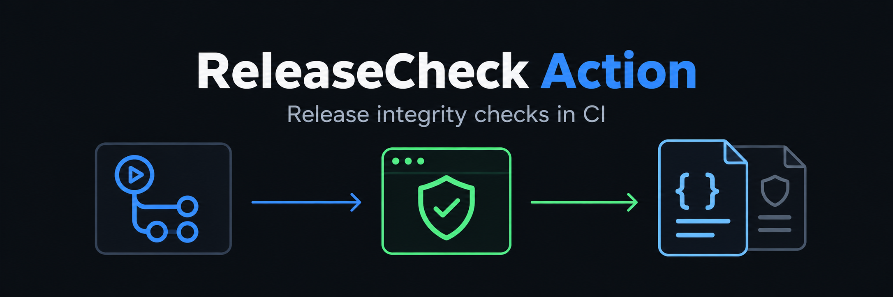

<p align="center">
  
</p>

<p align="center">
  Run <a href="https://github.com/ReleaseCheck/releasecheck">ReleaseCheck</a> from GitHub Actions to collect release-integrity evidence for an npm or PyPI package.
</p>

<p align="center">
  <a href="https://github.com/ReleaseCheck/releasecheck-action/actions/workflows/ci.yml"></a>
  <a href="LICENSE"></a>
</p>

[Core repository](https://github.com/ReleaseCheck/releasecheck) · [User documentation](https://github.com/ReleaseCheck/releasecheck-docs) · [Action security policy](SECURITY.md) · [Contributing](CONTRIBUTING.md)

The Action invokes a released ReleaseCheck core binary. It does not reimplement registry metadata handling, archive inspection, source comparison, security analysis, or provenance parsing.

## Status

The Action's CI passes. ReleaseCheck `v0.1.2` is publicly released, and the manual [Action E2E workflow](.github/workflows/e2e.yml) has passed against that exact core release. The workflow run is recorded in the core repository's release documentation. The cross-platform acquisition path is covered by the repository's Ubuntu, macOS, and Windows CI jobs.

The Action supports Ubuntu and macOS runners through Bash plus Windows runners through PowerShell. Linux/macOS use `curl`, `tar`, and SHA-256 tooling; Windows uses PowerShell HTTPS, SHA-256, and ZIP APIs. Supported release targets are Linux amd64/arm64, macOS amd64/arm64, and Windows amd64.

## Usage

The following example uses the public Action repository for readability. For production workflows, pin the Action to a reviewed full commit SHA and keep the core version explicit.

```yaml
jobs:
  verify-release:
    runs-on: ubuntu-latest
    steps:
      - uses: ReleaseCheck/releasecheck-action@main
        with:
          ecosystem: npm
          package: example-package
          releasecheck-version: 0.1.2
          format: sarif
          output: releasecheck.sarif
```

The `releasecheck-version` input is required and must be an explicit semantic version. The Action selects the matching archive for the runner platform and verifies its SHA-256 checksum before execution. The public v0.1.2 core release has been exercised through the Action E2E workflow; pin a reviewed Action commit for production use.

Inputs:

- `ecosystem`: `npm` or `pypi`.
- `package`: package name.
- `version`: optional package version.
- `artifact`: optional PyPI release filename.
- `timeout`: ReleaseCheck timeout, default `30s`.
- `releasecheck-version`: released core version without `v`.
- `format`: `human`, `json`, or `sarif`; default `json`.
- `output`: report path relative to the workspace; default `releasecheck-report.json`.

The Action propagates ReleaseCheck exit codes: `0` for `MATCH`, `1` for `REVIEW` or `INCOMPLETE`, `2` for usage errors, and `3` for operational errors.

## Boundaries

The core tool never installs or executes the package being inspected. This Action does not invoke npm, pip, package installation scripts, build backends, or arbitrary package code. It only downloads and executes the explicitly selected ReleaseCheck release binary.

For actual verification semantics and limitations, read the [core README](https://github.com/ReleaseCheck/releasecheck) and [public documentation](https://github.com/ReleaseCheck/releasecheck-docs).

## Development

```text
bash tests/validate-action.sh
```

Keep the core version explicit and do not treat a successful Action run as proof that the inspected package is safe or that source and artifact are byte-for-byte equivalent.
